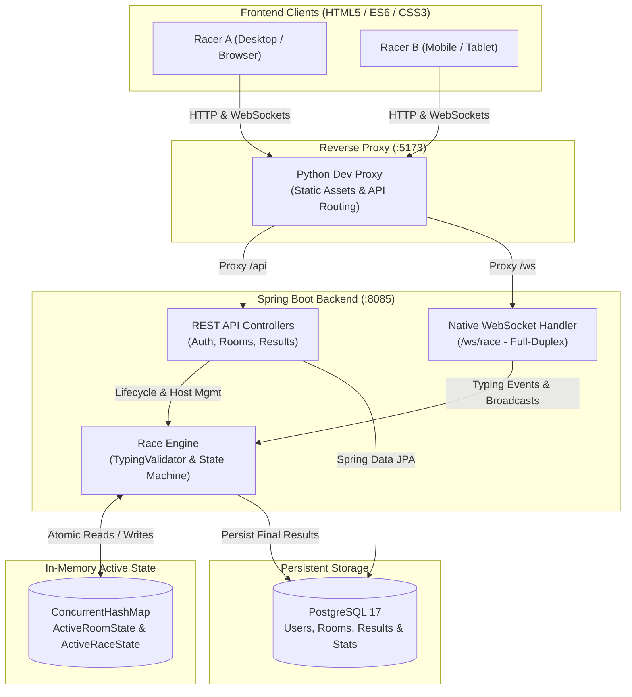

# TypeVerse ⌨️
### Real-Time Multiplayer Typing Competition Platform with Server-Authoritative Validation

[](https://spring.io/projects/spring-boot)
[](https://www.oracle.com/java/)
[](https://docs.spring.io/spring-framework/reference/web/websocket.html)
[](https://www.postgresql.org/)
[](https://flywaydb.org/)
[](https://maven.apache.org/)

---

## 📖 About the Project

**TypeVerse** is a high-performance, real-time multiplayer typing race platform built with Spring Boot and native WebSockets. Racers create or join competitive grid rooms via 6-character room codes and race muscle cars across an asphalt track in real time. The platform enforces zero client authority—every keystroke is validated on the backend to guarantee fair competition, accurate WPM tracking, and atomic single-winner resolution.

---

## 📸 Application Screenshots

### 1. Authentication & Onboarding
Dual-mode login and registration interface featuring BCrypt password hashing and JWT authentication.


### 2. Home Dashboard
Room creation and joining hub supporting custom racer capacities (2–10 racers) or instant guest entry.


### 3. Waiting Lobby
Pre-race paddock showing real-time participant roster, unique vehicle color assignments, and host controls.


### 4. Live Race Track
Synchronized multiplayer racing arena with real-time progress bars, dynamic WPM metrics, and finish detection.


---

## ⚡ Key Features

* **Server-Authoritative Validation:** Keystrokes are verified against canonical passages on the backend with monotonic sequence counters, preventing client tampering.
* **Atomic Single-Winner Resolution:** Concurrent race completions are governed by thread locks and atomic state references to ensure an undisputable 1st place winner.
* **Dynamic Multiplayer Grids:** Flexible room capacities (2–10 racers) with room code generation and automatic join validation.
* **Host Reassignment & Auto-Cleanup:** Automatic host promotion upon creator departure and automatic room reclamation when all racers disconnect.
* **Disconnection Grace Window:** A 15-second reconnection grace period preserves active player positions during transient network drops.
* **Stateless Auth & Guest Play:** Registered accounts via HMAC-SHA256 JWTs alongside instant cryptographic guest sessions.
* **Strict Anti-Cheat Engine:** Frontend paste event blocking (`Ctrl+V`, context menus, drag-and-drop) paired with backend keystroke sequence verification.
* **Real-Time WPM & Accuracy Metrics:** Instant calculation of net words per minute and character accuracy broadcasted over WebSockets.
* **Dual-Tier State Architecture:** High-speed volatile race state managed in thread-safe memory stores, with permanent statistics persisted in PostgreSQL 17.
* **Responsive Theming:** Clean Dark and Light mode support with responsive layouts for mobile, tablet, and desktop viewports.

---

## 🏛 System Architecture



---

## 🛠 Tech Stack

| Layer | Technology | Purpose |
| :--- | :--- | :--- |
| **Frontend** | Vanilla HTML5, CSS3, JavaScript (ES6+) | Lightweight, dependency-free responsive client |
| **Backend Core** | Spring Boot 3.2.5, Java 17 / 21 LTS | REST controllers, security filters, and race coordinator |
| **Real-Time Transport** | Spring WebSocket (`TextWebSocketHandler`) | Low-overhead, bi-directional JSON event streaming |
| **Security & Auth** | Spring Security 6, JJWT (HMAC-SHA256), BCrypt | Stateless token authentication and password hashing |
| **Relational Database** | PostgreSQL 17, Spring Data JPA, Hibernate | Persistent storage for users, race results, and statistics |
| **Schema Migration** | Flyway 10 | Versioned, automated SQL database migrations |
| **In-Memory Store** | Java Concurrency (`ConcurrentHashMap`, Atomic CAS) | Zero-latency thread-safe active room & race state |
| **Build & Tooling** | Maven 3.9, Docker Compose | Project build management and database containerization |

---

## 📂 Project Directory Structure

```
Backend_java/
├── backend/                      # Spring Boot 3 backend application
│   ├── src/main/java/com/yourname/typingrace/
│   │   ├── config/               # Security, WebSocket, and CORS configurations
│   │   ├── controller/           # REST endpoints (Auth, Room, Result)
│   │   ├── entity/               # JPA entities (User, Room, Result, Passage)
│   │   ├── repository/           # Spring Data JPA repositories
│   │   ├── service/              # Core business & token logic
│   │   ├── state/                # In-memory ActiveRoomState & ActiveRaceState
│   │   └── websocket/            # RaceWebSocketHandler & event payloads
│   ├── src/main/resources/       # application.yml & Flyway SQL migrations
│   └── pom.xml                   # Maven dependencies and build configuration
├── database/                     # Docker Compose configuration for PostgreSQL 17
│   └── docker-compose.yml
├── docs/screenshots/             # Application UI walkthrough images
└── frontend/                     # Vanilla SPA client
    ├── css/                      # Modular stylesheets (theme, components, race track)
    ├── js/                       # Client modules (auth, room, socket, race engine)
    ├── assets/                   # SVG vector race cars and keyboard logo
    ├── index.html                # Single-page application markup
    └── dev-server.py             # Development server and API/WebSocket reverse proxy
```

---

## 🚀 Getting Started

### Prerequisites
- **Java JDK 17** or **21 LTS** &nbsp;|&nbsp; **Docker Desktop** (PostgreSQL) &nbsp;|&nbsp; **Python 3.x** (Dev Proxy)

### 1. Start Database
```bash
cd database
docker compose up -d
```
*PostgreSQL 17 initializes on port `5432` with automatic Flyway migrations.*

### 2. Start Backend Service
```bash
cd backend
.\mvnw.cmd spring-boot:run
```
*Spring Boot API and WebSocket server start on `http://localhost:8085`.*

### 3. Start Frontend Client
```bash
cd frontend
python dev-server.py 5173
```
*Access the application in your browser at **[http://localhost:5173](http://localhost:5173)**.*

---

## 🧪 Testing

TypeVerse includes a comprehensive test suite of 109 automated tests covering unit tests, controller integrations, anti-cheat validation, concurrent race state transitions, database persistence, and multi-client WebSocket flows.

```bash
cd backend
.\mvnw.cmd clean test
```
